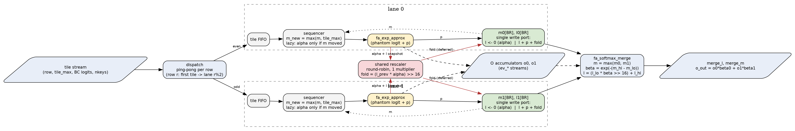
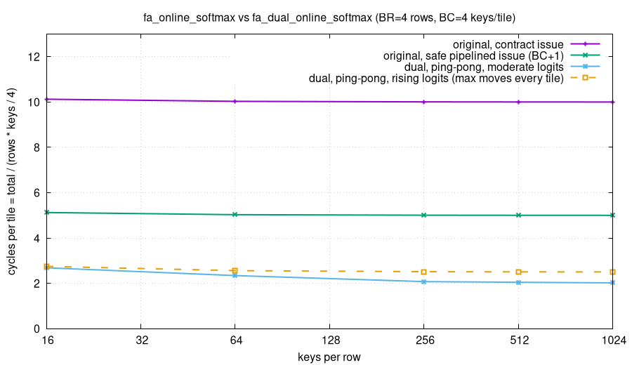

<!-- SPDX-License-Identifier: AGPL-3.0-only OR LicenseRef-SnapKitty-Opaque-1.0 -->
<!-- Copyright Ahmad Ali Parr -->

# Dual online softmax

[](LICENSE)
[](rtl/src)
[](https://www.veripool.org/verilator/)
[](sim/fa_dual)
[](#benchmark)

A two-lane online softmax unit in SystemVerilog for a FlashAttention-style engine.

The key tiles of each row are split between two lanes. Each lane keeps its own running max
`m` and denominator `l` and has its own exp unit, so both lanes work at the same time. When a
lane's max moves, the rescale factor `alpha = exp(-(m_new - m_old))` goes through that lane's
exp pipe as one extra "phantom" logit, and when the max does not move nothing is issued. The
old `l` is handed to one shared multiplier and the lane starts a fresh `l` at 0, so rescaling
and accumulation overlap. At the end of a row the two lane states are merged exactly:

```
m = max(m0, m1)
l = l_hi + l_lo * exp(-(m_hi - m_lo))
```

## Dataflow



## Benchmark

Measured with the Verilator testbench (`make sim`), against the original single-lane
`fa_online_softmax` with safe pipelined issue. BR = 4 rows, BC = 4 keys per tile.

| | original (pipelined) | dual |
|---|---:|---:|
| cycles, 4 rows x 1024 keys | 5,122 | 2,071 |
| speedup, 1024 keys | 1.00x | 2.47x |
| speedup, sweep 16 to 1024 keys | | 1.57x to 2.47x |
| max relative error of `l` | 1.574e-2 | 9.752e-3 |
| max error / proven bound | 0.421 | 0.322 |
| write collisions | 0 | 0 |

Random regression: 700 cases, 1,722 rows, 115,255 logits, 0 errors.
With rising logits (the max moves every tile) the dual unit still runs about 2.0x faster.



## How it works

- **Ping-pong dispatch.** Tiles of a row alternate between lane 0 and lane 1.
- **Phantom-logit alpha.** The rescale factor is computed by the lane's own exp unit as one
  extra logit, so there is no second exp unit per lane.
- **Lazy rescale.** If a tile does not raise the row max, no alpha is issued.
- **Frame split, deferred rescale.** On a new max the lane snapshots `l`, restarts it at 0
  and keeps adding `p`. The shared multiplier later adds back `(l_prev * alpha) >> 16` in the
  same single write as the next `p` (`l + p + fold`).
- **Exact merge.** `fa_softmax_merge` combines `(m0, l0)` and `(m1, l1)` with one exp per row
  and uses the same factors to merge the output accumulators.

The full algorithm, the merge proof, the fixed-point error bound and the timing are in
[docs/dual-online-softmax.md](docs/dual-online-softmax.md).

## Run it

Needs Verilator 5.054 (or close), make, and for the figures gnuplot and graphviz.

```
git clone https://github.com/AHMADALIPARR/dual-online-softmax.git
cd dual-online-softmax
make sim     # builds and runs the testbench, ends in "errors = 0" and PASS
make figs    # renders docs/img/*.svg and *.png from the measured cycles
```

`SIM=icarus sh sim/fa_dual/run.sh` only elaborates the RTL with Icarus Verilog.

## Repo map

| path | what |
|---|---|
| `rtl/src/fa_dual_online_softmax.sv` | two lanes, dispatcher, shared rescaler, merge wrapper |
| `rtl/src/fa_softmax_merge.sv` | exact merge of two `(m, l)` states and the output merge |
| `rtl/src/fa_online_softmax.sv` | original single-lane unit, the reference baseline |
| `rtl/src/fa_exp_approx.sv` | exp approximation used by both units |
| `rtl/src/fa_pkg.sv` | shared constants and tables |
| `sim/fa_dual/tb_fa_dual.sv` | testbench: original vs dual, exact reference, error bound, cycles |
| `sim/fa_dual/run.sh` | builds and runs the testbench |
| `docs/dual-online-softmax.md` | algorithm, proof, error bound, timing |
| `docs/img/` | dataflow and cycles figures (graphviz, gnuplot) and the measured data |
| `Makefile` | `make sim`, `make figs` |

## License

Dual-licensed under AGPL-3.0-only or the SnapKitty Opaque Source License 1.0. See [LICENSE](LICENSE).
