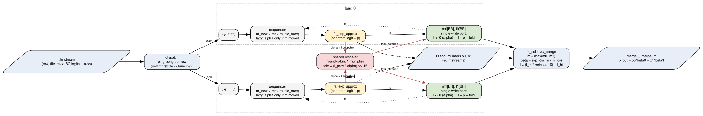
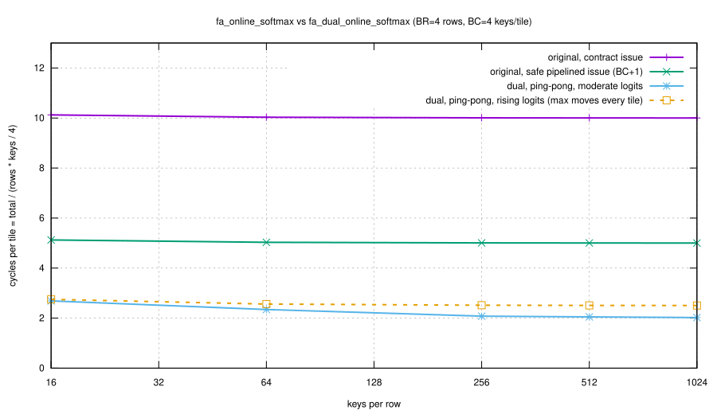

<!-- SPDX-License-Identifier: AGPL-3.0-only OR LicenseRef-SnapKitty-Opaque-1.0 -->
<!-- Copyright Ahmad Ali Parr -->

# Dual online softmax (`fa_dual_online_softmax`)

Two-lane ("dual-processor") version of `fa_online_softmax`. It adds a phantom-logit
rescale, a lazy rescale, a frame-split rescale that is deferred to one shared multiplier,
and an exact final merge.

Files:

| file | what |
|---|---|
| `rtl/src/fa_dual_online_softmax.sv` | two lanes, dispatcher, shared rescaler, merge wrapper |
| `rtl/src/fa_softmax_merge.sv` | exact merge of two `(m, l)` states plus the O-accumulator merge |
| `sim/fa_dual/tb_fa_dual.sv`, `sim/fa_dual/run.sh` | SystemVerilog testbench (Verilator) |
| `docs/img/dual_dataflow.dot` / `.svg` | dataflow figure (graphviz) |
| `docs/img/cycles.gp`, `cycles.dat` / `cycles.svg` | measured cycles (gnuplot; data written by the TB) |

Units are the same as in the rest of the engine:
- logits are signed, in units of 1/256;
- `p`, `alpha` and `beta` are Q0.16 (65536 = 1.0), from `fa_exp_approx`;
- `l` and `o` are 64-bit;
- `NEG_INF = -2^30`, `BR = 4`, `BC = 4`.

---

## 1. Algorithm in brief

The key tiles of each row are split between two lanes. Each lane keeps its own running
max `m_k` and denominator `l_k` and runs its own exp unit, so the two lanes run at the
same time. When a lane's max changes, the rescale factor `alpha = exp(-(m_new - m_old))`
is not computed on a second exp unit. It is issued as one extra "phantom logit" through
the lane's own exp pipe. If the max did not change, nothing is issued (lazy rescale).

When `alpha` comes back, the lane does not multiply in place. It hands the old `l` to a
**shared** rescaler and restarts that row's `l` at 0 (a frame split). New `p`s keep
accumulating in the new frame. A couple of cycles later, the scaled old value
`(l_prev * alpha) >> 16` is added back through the same single write port (`l + p + fold`).
Rescaling and accumulation therefore overlap in time, and the two lanes take turns on the
one multiplier.

At the end of a row, `fa_softmax_merge` combines the two lane states exactly:
`m = max(m0, m1)`, `l = l_hi + l_lo * exp(-(m_hi - m_lo))`. This needs one exp per row, and
only the lane with the lower max is rescaled. The same `beta` pair then merges the output
accumulators column by column.

```
for each tile (row r, tile_max, logits) -> lane k = dispatch(r)           // ping-pong per row
    m_new = max(m_k[r], tile_max)
    if m_k[r] != -inf and m_new != m_k[r]:                                // lazy
        issue phantom logit: alpha = E^(m_new - m_k[r])                   // own exp unit
        on writeback: snapshot l_k[r] -> rescaler, l_k[r] = 0             // frame split
        rescaler (shared, later): fold = floor(l_prev * alpha / 2^16)
                                  l_k[r] += fold  (in the same write as a p, if one lands)
    m_k[r] = m_new
    for each logit x: p = E^(m_new - x); l_k[r] += p
merge(r): m = max(m0, m1); beta_lo = E^(m - min(m0, m1)); beta_hi = 65536
          l = floor(l_lo * beta_lo / 2^16) + l_hi ;  o = (o0*beta0 >>> 16) + (o1*beta1 >>> 16)
```

## 2. What is new compared with split-K / FlashDecoding

Split-K and FlashDecoding split the keys over independent workers and merge the partial
`(m, l, o)` states at the end. That reduction is the only thing they share with this design
(this design uses the same exact merge). The new parts are inside each worker and in how
the workers share hardware:

1. **Phantom-logit rescale.** `alpha` is just `exp` of a "logit" equal to the old max,
   relative to the new max. It goes through the lane's own `p` pipe, one slot ahead of the
   tile's logits, so there is no second exp unit per lane. The original module has two exp
   units, `u_exp_alpha` and `u_exp_p`.
2. **Lazy rescale.** The alpha slot is issued only when the max actually moves. In the
   fixed-point domain this is *bit-exact*: `E^(0) = 65536` and `(l * 65536) >> 16 = l`, and
   on the first tile `l = 0`. In steady state a tile therefore costs `BC` cycles instead of
   `BC + 1`. The random regression issued only 16 368 alphas against 60 992 lazy skips.
3. **Frame-split deferred rescale on a shared multiplier.** Each lane snapshots and zeroes
   `l`, keeps accumulating, and later folds `floor(l_prev*alpha/2^16)` back. The integer is
   identical because integer addition commutes (proof in section 4). This takes the 64x17
   multiply off the accumulation path. Both lanes share **one** rescale multiplier
   (round-robin), and the fold is merged with a concurrent `p` into one write (13 917 of
   16 368 folds landed in the same cycle as a `p`). By construction, no register ever sees
   two writes in one cycle.
4. **Ping-pong per row.** Row `r` starts on lane `r % 2`, and the lanes then alternate tiles.
   With several rows in flight, one lane is rescaling row A while the other accumulates row
   B, and the two swap on the next tile.
5. **Batched rescale at merge.** Only the lower-max lane is rescaled, with one exp per row.
   The `beta` pair is held and applied to all `d` columns of O as they stream through.

## 3. Dataflow and timing



The figure source is `img/dual_dataflow.dot`. To regenerate it, run
`dot -Tsvg dual_dataflow.dot -o dual_dataflow.svg`.

### One lane: a tile whose max moves (BC = 4), followed by a lazy tile

```
cycle            c      c+1     c+2     c+3          c+4     c+5     c+6     c+7     c+8
issue (exp in)   a      p0      p1      p2           p3      q0      q1      q2      q3      <- next tile: no alpha (lazy)
writeback        .      a       p0      p1           p2      p3      q0      q1      q2
l[r] write       .      l<=0    l+=p0   l+=p1+fold   l+=p2   l+=p3   l+=q0   ...
rescaler         .      .       req     fold_val     .
                               (grant) (registered) -> added at c+3, combined with p1
pend             .      1       1       1            0
```

- The snapshot (`l <= 0`) and the fold of the same lane cannot fall in the same cycle.
  `pend` blocks a second alpha from that lane until its fold has landed. The TB probe
  `req_set && fold_here` counted 0 such cycles.
- With `BC = 4` the fold always lands before the lane's next alpha could be issued, so
  full tiles never stall. Tiles of 1 or 2 keys can stall: the directed test with one key
  per tile and a rising max recorded 187 stall cycles, and the result is still bit-exact.

### Both lanes, two rows in flight (ping-pong, schematic)

```
cycle      0   1   2   3   4   5   6   7   8   9   10  11  12
lane 0     a0  r0  r0  r0  r0  b1  r1  r1  r1  r1  a0' r0  r0 ...   (row 0 tile 0, row 1 tile 1, row 0 tile 2)
lane 1     a1  r1  r1  r1  r1  b0  r0  r0  r0  r0  ...              (row 1 tile 0, row 0 tile 1)
rescaler           L0  L1          L1  L0          ...              (one multiply per cycle, round-robin)
```

`aK`/`bK` mark an alpha slot (or a skipped one) for row K, and `rK` marks a `p` for row K.
While lane 0 accumulates row 0, the rescaler is busy with lane 1's row-1 snapshot, and
the reverse also happens.

### The original module, for comparison

`fa_online_softmax` documents "one operation at a time". Its safe pipelined rate is
`tile_start` followed by `BC` `p_start`s, so `BC + 1 = 5` cycles per tile on one row.
`fa_engine` waits for `*_valid` after each operation ("contract" issue), which gives about
`2 (BC + 1) = 10` cycles per tile.

## 4. Proof that the result is the exact softmax denominator

Notation:
- `E(d) = 2^16 e^(-d/256)` is the exact value, and `Ê(d)` is `fa_exp_approx`.
- For a row with logits `x_1..x_N` and `M = max x_j`, the target is `L* = sum_j E(M - x_j)`
  (that is, `2^16 * sum e^((x_j - M)/256)`).

**(a) Real-math exactness: the state is a monoid.** For a set `S` of logits, define
`st(S) = (m_S, l_S) = (max_S x, sum_{j in S} E(m_S - x_j))`. For disjoint `S` and `T`, with
`m = max(m_S, m_T)`:

```
l_{S u T} = sum_{S u T} E(m - x_j) = sum_S E(m - m_S) E(m_S - x_j) / 2^16 + sum_T ...
          = l_S * E(m - m_S)/2^16 + l_T * E(m - m_T)/2^16
```

This uses `E(a+b) = E(a)E(b)/2^16`. The operator
`(m_S,l_S) (+) (m_T,l_T) = (max, l_S E(m-m_S)/2^16 + l_T E(m-m_T)/2^16)` is associative and
commutative, and `(-inf, 0)` is its identity. The following are all instances of `(+)`:
- one online-softmax step (a tile), with `alpha = E(m_new - m_old)`;
- the lazy skip (`E(0) = 2^16`);
- the lane merge (`beta_hi = E(0)`, `beta_lo = E(m - m_lo)`);
- the deferred fold, where `l_prev * alpha` is added later.

Folding the tiles in **any** partition between the lanes, and in **any** order, therefore
gives `st(all logits) = (M, L*)`. The output accumulators `o_S = sum_S E(m_S - x_j) v_j`
obey the same identity, so `o/l` is the exact softmax-weighted average.

**(b) Each lane is bit-exact with the original on its own subset.** In integers, the
original computes `l' = floor(l * Ê(Δ) / 2^16) + sum p_i` for a tile. The dual lane:
- skips the step when `Δ = 0` (the integer identity) or when `m_old = -inf`
  (`l = 0`, and the result is 0 both ways);
- otherwise stores `l_new_frame = sum p_i` and adds `floor(l_prev * Ê(Δ)/2^16)` once.

`pend` ensures that no other snapshot of that lane intervenes, so the sum is the same
integer. The TB checks this exactly, lane by lane: `model_dual` uses the lane assignment
the DUT really made, and the comparison is `==` on 64-bit integers.

**(c) Fixed-point error bound.** An exhaustive scan of all 4096 inputs of `fa_exp_approx`,
plus the clamp region, gives this bound:

```
|Ê(d) - E(d)| <= rho * E(d) + A,      rho = 6.3106e-3,   A = 0.9826 LSB (Q0.16)
```

Here `rho` is the maximum relative error over `E >= 1024`. `A` absorbs the small-`E` tail
and the clamp: for `d >= 4096`, `E < 2^16 e^-16 = 0.0074`. Track
`|l̂ - L| <= R L + B` per accumulator, with `cnt` = the number of `p`s (so `L <= cnt * 2^16`):

| step | R' | B' |
|---|---|---|
| start | 0 | 0 |
| add `p` | `max(R, rho)` | `B + A` |
| rescale by `α̂` (also the merge of the lower lane) | `R + rho + R*rho` | `B(1 + rho + A/2^16) + (1+R)·cnt·A + 1` |
| merge `hi + lo'` | `max(R_hi, R_lo')` | `B_hi + B_lo'` |

The rescale row comes from
`l̂ α̂/2^16 - L α/2^16 = ηL' + e·α(1+η)/2^16 + (L+e)c/2^16`. Its terms are bounded as follows:
- `|e| <= RL + B`, `|η| <= rho` and `|c| <= A`;
- `α <= 2^16`;
- the `+1` is the floor.

A skipped (lazy) rescale contributes nothing. This is why the dual has fewer error
compounding steps than the original, whose `R` grows by `rho` at every max change. The
bound `R·L* + B` is evaluated per row in the TB, and every row of every case is checked
against it.

## 5. Results (Verilator 5.054, `sim/fa_dual/run.sh`)

The TB drives the same rows through `fa_online_softmax` and through two
`fa_dual_online_softmax` instances: ping-pong (`PINGPONG=1`) and least-loaded
(`PINGPONG=0`). It checks:
- `l` against a bit-exact integer model of each design;
- `l` against the real-math `L*`, within the bound above;
- `O = o/l` against the exact real softmax average;
- same-cycle write collisions.

Random regression: 700 cases, 1722 rows, 115 255 logits. Rows hold 1 to 160 keys. Tiles
hold `BC` keys, or a random 1 to `BC` keys in every third case. The seven logit
distributions are:
- moderate;
- rising (the max moves every tile);
- falling;
- wide `±20000`;
- random walk;
- all equal;
- the full `±262144` logit range.

| check | original | dual |
|---|---|---|
| `l` == bit-exact integer model | 0 mismatches | 0 mismatches (both dispatch modes) |
| max `|l - L*| / L*` | 1.574e-2 | 9.752e-3 |
| max (error / proven bound) | 0.421 | 0.322 |
| max `|O - O*|` (1/256 units) | 4.913 | 3.913 |
| same-cycle write collisions | 0 (safe issue) | 0 |
| cycles, sum over 700 cases | 309 270 (contract), 155 335 (pipelined) | 71 105 (ping-pong), 70 858 (least-loaded) |

The largest relative errors come from the full-range distribution. `|l_dual - l_orig|`
reached at most 8350 LSB (6.7e-3 of `L*`). The two designs round differently, and both
stay inside their bounds; the dual is closer to `L*`.

Throughput sweep (BC = 4; total cycles including drain and merge):



| rows | keys | logits | orig contract | orig pipelined | dual ping-pong | speedup vs pipelined |
|---|---|---|---|---|---|---|
| 4 | 16 | moderate | 162 | 82 | 43 | 1.91x |
| 4 | 64 | moderate | 642 | 322 | 150 | 2.15x |
| 4 | 256 | moderate | 2562 | 1282 | 532 | 2.41x |
| 4 | 1024 | moderate | 10242 | 5122 | 2071 | 2.47x |
| 4 | 1024 | rising | 10242 | 5122 | 2564 | 2.00x |
| 4 | 1024 | random walk | 10242 | 5122 | 2128 | 2.41x |
| 1 | 1024 | moderate | 2562 | 1282 | 520 | 2.47x |
| 1 | 1024 | rising | 2562 | 1282 | 644 | 1.99x |

`docs/img/cycles.dat` holds the full sweep. Steady state per tile is:
- the original: `BC + 1 = 5` cycles pipelined, or 10 with contract issue;
- the dual: `BC / 2 = 2` cycles when the max is stable, and `(BC + 1) / 2 = 2.5` when it
  moves on every tile.

That is up to 2.5x over the original's best safe issue, and about 5x over contract issue.
Two lanes give 2x of this, and the lazy skip gives the remaining 1.25x.

Directed tests:
- **Original with overlapped issue** (the next `tile_start` in the same cycle as the last
  `p_start`): 7 same-cycle alpha/p write-backs, and 2 of 2 rows wrong
  (`l = 807174`, correct `636044`). This is documented as a contract in the original,
  but nothing enforces it.
- **Dual, one key per tile, rising max:** 187 stall cycles (the `pend` interlock), bit-exact.

`SIM=icarus ./run.sh` only elaborates the RTL with Icarus 13. The TB's bound tracker uses
unpacked structs with `real` members, which Icarus does not support. Yosys 0.69 cannot read
the package-import-in-header style used across the repo (`module x import fa_pkg::*; (`),
so there are no synthesis numbers.

## 6. Issues found in `fa_online_softmax` (reported, not changed)

1. **Lost update on overlap.** If `ea_valid` and `ep_valid` fire in the same cycle, the later
   nonblocking assignment (`l + p`) overwrites `l * alpha`. This happens when `tile_start`
   is issued together with the last `p_start`.
2. **Same overlap, wrong row.** `row_q` has already switched, so the last `p` of the previous
   row is added to the new row.
3. **Stale max.** A `p_start` in the same cycle as `tile_start` uses the old `cur_m`.
4. **`init` does not reset `cur_m` or `row_q`.** An `ea_valid` or `ep_valid` in flight in the
   same cycle as `init` overrides the `l` clear for `row_q`.
5. **No row interleaving.** `p_start` has no row input, so it always goes to the row of the
   last `tile_start`.
6. **No lazy path.** The alpha exp and the 64x17 multiply are spent on every tile, even
   when the max did not move. Each such multiply also adds a rounding step.
7. **Missing tile start.** A `p_start` before any `tile_start` sees `cur_m = NEG_INF`, so
   `pdelta = 0` and `p = 1.0`.
8. **Throughput.** The safe rate is `BC + 1` cycles per tile. `alpha_valid`/`p_valid` arrive
   two cycles after issue, so contract-style issue (as in `fa_engine`) costs about
   `2(BC + 1)`.

Items 1 to 3 break the "one operation at a time" contract written in the header, but there
is no assertion or interlock. The TB's overlap demo shows the wrong `l`. The dual design
avoids all eight issues:
- single write per register;
- per-tile row and max;
- `pend` interlock;
- lazy skip;
- the lane state resets on `init`.

## 7. Reproduce

```
make sim     # Verilator 5.054: prints the tables above, writes sim/fa_dual/cycles.dat, ends in PASS
make figs    # copies cycles.dat to docs/img, renders cycles and dataflow to SVG and PNG (gnuplot, graphviz)
```
